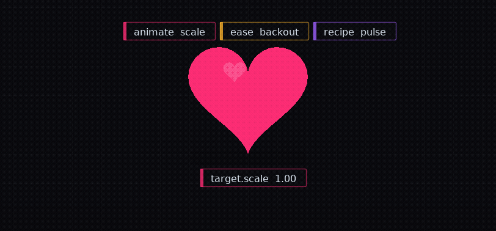
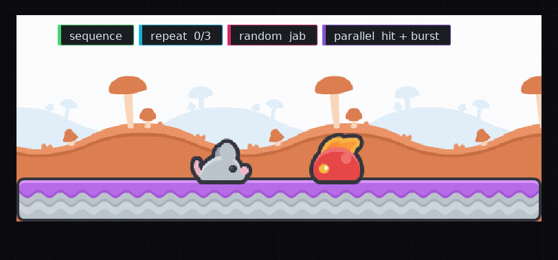
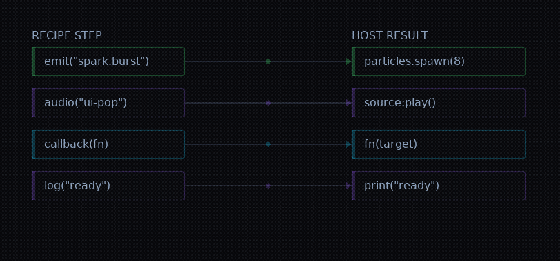
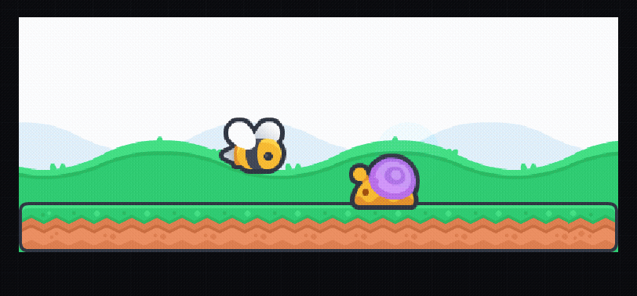
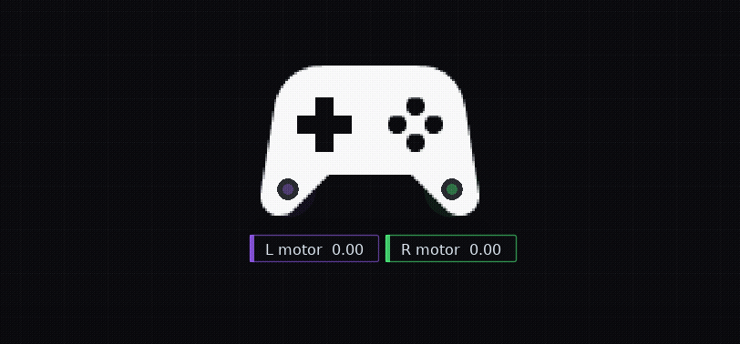
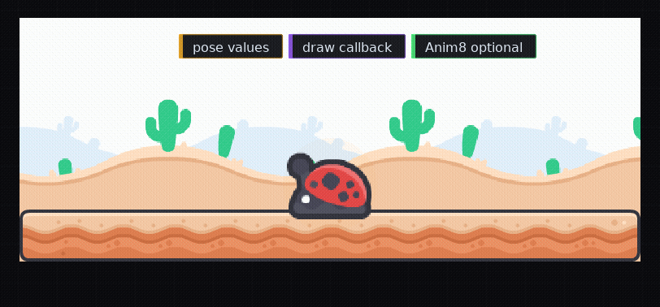
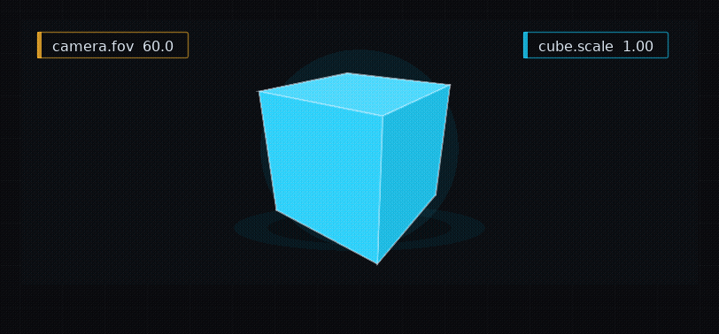
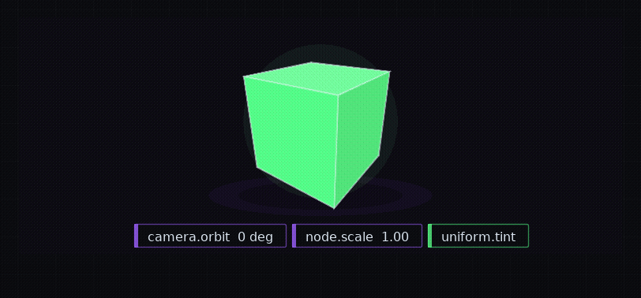

# feel.lua Docs

## What Is feel.lua?

`feel.lua` is a small feedback sequencing library for Löve. It lets you describe moment-to-moment game feel as reusable Lua recipes: tween these values, wait, play these steps in parallel, emit this particle/sound/shake event, then settle back.

The core does not own your rendering, audio, particles, shaders, models, or game objects. You keep those in your app. `feel.lua` owns the timing and target values, then hands side effects back to you through callbacks or optional adapters.

Use it when an action should read better: a button press, player hit, reward reveal, camera punch, UI pulse, shader sweep, sound cue, haptic tick, or a named feedback stack that combines several of those at once.

## Structure

`feel.lua` is split into a tiny core recipe runner and opt-in LOVE helpers. These docs group related features together so you can read the layer you are working in.

## What To Read First

1. [Installation](installation.md): add the core module and, optionally, the LOVE adapter.
2. [Getting Started](getting-started.md): build a minimal LOVE loop with one animated target and one sequence.
3. [Recipes](recipes.md): copy practical patterns for UI, impacts, pickups, loops, and transitions.
4. [Sequence Steps](sequence-steps.md): learn the table shapes that make up a recipe.
5. [LOVE Adapter](love-adapter.md): connect recipe events to sounds, haptics, particles, shaders, camera, screen, and post effects.
6. [LOVE Examples](love-examples.md): run the showcase or the Asteroidz example.

## Guides

| Page                                  | Use it for                                                                                                                        |
| ------------------------------------- | --------------------------------------------------------------------------------------------------------------------------------- |
| [Core Runner](core-runner.md)         | Targets, named sequences, playback, updates, clearing, and callback context.                                                      |
| [Recipes](recipes.md)                 | Copyable patterns for UI presses, impacts, pickups, loops, transitions, and feedback presets.                                    |
| [Sequence Steps](sequence-steps.md)   | `animate`, `emit`, `audio`, `wait`, `play`, `parallel`, `repeat`, `random`, `callback`, and `log`.                                |
| [API](api.md)                         | Compact function signatures, options, and exported helpers.                                                                       |
| [Autocomplete](autocomplete.md)       | LuaLS setup, local definition files, LOVE2D types, and custom target values.                                                      |
| [Haptics](haptics.md)                 | Reusable pulse patterns, built-in semantic presets, intensity settings, cancellation, and custom hardware drivers.               |
| [Sprite Effects](sprite.md)           | Renderer-independent recoil, squash, tint, opacity, draw callbacks, and an optional Anim8 helper.                                |
| [LOVE Adapter](love-adapter.md)       | Registered sound cues, haptics, particle systems, shaders, post-processing, camera events, screen overlays, and adapter handlers. |
| [Post Processing](post-processing.md) | Built-in LOVE canvas effects, parameters, and recipes.                                                                            |
| [g3d Helpers](g3d.md)                 | Optional helpers for binding `feel.target` values to groverburger/g3d models and cameras.                                         |
| [Menori Helpers](menori.md)           | Optional helpers for binding `feel.target` values to Menori nodes, cameras, animations, and uniforms.                             |
| [Writing a Custom Adapter](custom-adapter.md) | The adapter contract, with a minimal runnable example.                                                                    |
| [Best Practices](best-practices.md)   | Recipe organization, easing/duration tuning, restart discipline, and reset patterns.                                              |
| [Troubleshooting](troubleshooting.md) | Common gotchas: nothing animates, restart vs stacking, run control, validation, and version notes.                                |
| [Core Example](core-example.md)       | A plain-Lua, no-LOVE walkthrough of the core runner.                                                                              |
| [LOVE Examples](love-examples.md)     | Showcase scenes and feature-specific examples.                                                                                    |
| [Asteroidz Walkthrough](asteroidz.md) | A small game showing sequences, post-processing, UI juice, and adapter events together.                                           |

<!-- feel:feature-gif-gallery -->
## Feature GIFs

| Feature | Preview |
| --- | --- |
| Motion Basics |  |
| Combo Recipe |  |
| Host Integration |  |
| Impact Feedback |  |
| Haptics |  |
| Sprite / Anim8 |  |
| g3d |  |
| Menori |  |
<!-- /feel:feature-gif-gallery -->
